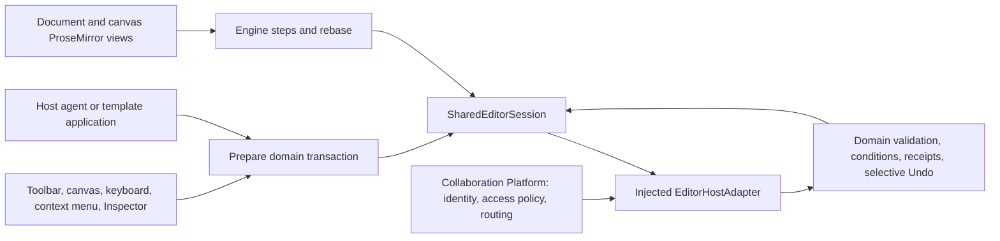

# Normal editor collaboration (#5)

The normal `/` editor supports both serverless local editing and an injected shared
session. The icon toolbars, shape picker, canvas, page/layer rails and panels are the
same components. `/collaboration.html` remains the separate Issue #3 verification Lab.



## Use the reference Host

Run `npm run dev` and `npm run collaboration:server`. Create or import an ordinary
artifact, then use **More artifact actions → Open collaboratively**. **Open peer editor**
opens the same artifact as B; use a separate browser profile/context for an independent
client. A/B/C identities and the transport/permission fault controls are reference Host
fixtures, not Editor authentication or policy. The authority is in memory; restarting
it removes shared artifacts, versions and uploaded assets. Export native JSON first.

Share initialization retains artifact and element IDs, copies its current draft and
annotations, and verifies existing immutable version hashes without migrating those
versions. An existing authority always wins over a later seed. This is an explicit
choice to open the existing shared artifact; the original local artifact remains in
IndexedDB. Invalid initialization leaves the local draft intact with an error.

## Embed in a different Host

Use the public `SharedEditorSession`, normal domain codec and an `EditorHostAdapter<T>`
implementation. Its identity/session/scopes and permission notifications must come from
the trusted Host. `apps/playground/src/embed.tsx` demonstrates all seven public surfaces;
it imports no Playground App/model, Room model or reference server. Its optional
`ep-independent-host` sessionStorage fixture injects an opaque HTTP connection for tests.
A real Host should construct the adapter directly using its own credential handling.

```tsx
const shared = new SharedEditorSession(slideEditorCodec, authorizedHostAdapter);
await shared.open();
// Subscribe shared.onChange to the Host's React render boundary.
<CanvasTextContext.Provider value={(id) => shared.text(id)}>
  <SlideSurface
    content={shared.content}
    readOnly={shared.readOnly}
    execute={(command) => shared.execute(command)}
    select={(ids, region) =>
      shared.select({
        addresses: [ids].flat().map((elementId) => ({
          artifactId: shared.confirmed.artifactId,
          elementId,
          region,
        })),
      })
    }
  />
</CanvasTextContext.Provider>;
```

Supply `DocumentSurface.textEngine={shared.text('text')}` for Document. Supply
`CanvasPresenceContext` for canvas selections and `EditorExportGuardContext` to block
view exports while input is pending/rejected or a proposal is being previewed. Display
`shared.annotations`, status and error in the Host; route replies/resolution through
`shared.actions`. Poll `sync()` for the example HTTP adapter, or use a subscription
adapter. Route Undo/Redo, save, restore and proposals through the shared session. On
exit retain `checkpoint()` when pending or rejected edits exist; `resume()` requires
the same identity and confirmed basis. Keep session checkpoints and credentials out of
ordinary exports. The reference Host retains checkpoints on unload and exposes download.

Await proposal application, Undo/Redo and restore before reading their completed
result. Their completion includes synchronization through the accepted receipt's
revision, even if a background poll began before the write. If a fresh read still
cannot reach that revision, the action reports `resync-required`; the Host should
retain recovery state and synchronize again rather than treat the old view as the
completed result.

For component unmount, call `session.suspend(checkpoint => persistSynchronously(checkpoint))`.
This retains queued edits and queued Undo/Redo targets before closing listeners and
stopping submission work. If persistence throws, the session remains live. A request
already sent can still be accepted; resume the retained checkpoint in a **new** session
with the same trusted identity to recover its receipt without double application.
`close()` continues to reject when pending work has not been retained. Closed sessions
cannot accept new commands or be reopened. Replace them with a new session instance
and resume the retained checkpoint; this also applies to `close()` followed by `open()`. Hosts own and clear their polling/unload listeners too.
Older schema-1 checkpoints without the optional history list resume as before.
Pending Redo intents also retain their Undo insertion position. A late Undo/Redo
acknowledgement updates the requested operation ID rather than the current stack
tail. Edits made while that response is outstanding keep their own history and
invalidate the previous Redo branch. A failed history call rejects to its caller;
after successful reconnect it does not poison subsequent history/save/restore.

For React rendering use `shared.viewContent`, an immutable cached projection.
`shared.content` remains a caller-owned copy. Neither adds a second domain source of
truth: the projection is invalidated by the optimistic snapshot or pending text doc.
Do not mutate rendering props. All writes use the command/text/proposal contracts.

For synchronous string storage, `shared.serializeCheckpoint()` produces the same
schema-1 JSON as `JSON.stringify(shared.checkpoint())` without copying large native
trees before serialization. It does not persist anything itself. Hosts still
handle storage failure, and `suspend(retain)` still requires a successful
synchronous write before detach. `checkpoint()` remains a caller-owned object.

For asynchronous structured storage, `shared.captureCheckpoint()` returns a
point-in-time frozen checkpoint. It copies mutable metadata, queues and history,
while sharing only native content already certified deeply frozen by the core.
Do not mutate it; use `checkpoint()` for a writable copy. Later input, confirmations
and history updates do not change an earlier capture. Both forms resume through
the same schema-1 API.

The reference playground Host writes changed checkpoints to IndexedDB during normal
operation. Preparation waits for browser idle time (with a one-second timeout and
a separate-task fallback), allowing pending input to paint before IndexedDB's
synchronous structured serialization. Unload/detach retains the latest input even
if preparation is still deferred; detach cancels the idle task. Its private store
orders writes independently of authority revisions:
a newer synchronous unload/detach backup takes precedence over an older in-flight
write. It reads legacy sessionStorage checkpoints and removes a superseded backup
only after the asynchronous transaction commits. Failed writes remain visible and
are retried; a failed synchronous detach keeps the session mounted. Recovery
download includes this tab's database records and backups, including unreadable
backup bytes. This reference storage policy does not change the public checkpoint
schema or promise persistence after browser storage is cleared.

Local Hosts may render the immutable result of `EditorSession.executeView(command)`.
The existing `execute`, `content`, `undo` and `redo` return caller-owned copies.
`immutableCommand` opts a pure native command into reading immutable input and
freezing its result, so it may reuse unchanged branches. Use ordinary `command`
for compatibility functions that mutate their input or retain mutable result data;
those still run against private copies. The built-in cell and canvas-transform
commands opt in after ownership/regression tests. This flag is local metadata,
not an authenticated wire capability or an authorization shortcut.

`DomainCodec.applyReadonly` is an optional pure preparation path: it must not
mutate any input branch even if validation fails. It may return shared unchanged
branches. Ordinary operation preparation uses it to derive dependencies/targets;
ordinary `evaluate()` and authority commit still isolate snapshots and run the
existing validation, permissions and precondition checks. Asset codec wrappers
retain encoding/strict decoding on this path. `CollaborationClient` and `evaluate`
also accept an explicit `{ immutableContent: true }` option: returned content is
frozen and unchanged frozen branches may be shared. SharedEditorSession uses this
option internally; its confirmed/optimistic content must be treated as read only.
Use `content` or `checkpoint()` for mutable copies. Direct CollaborationClient
users retain the previous mutable, isolated views unless they opt in. Mutable or
merely shallow-frozen Host input is copied before adoption, so this option cannot
introduce a writable external alias into retained state.

`prepareOperation` and the domain-level `prepareEditorProjection` additionally
return an opaque, immutable `PreparedOperation`. Its serializable `operation`
has the same protocol, actions, targets and conditions as ordinary preparation.
`CollaborationClient.enqueuePrepared` can reuse the checked native result for the
first pending edit, only when certified immutable content identity, all snapshot
metadata and codec methods still match the confirmed basis. An existing queue,
changed revision/stamps/text metadata/content/codec, or a mutable client takes the
ordinary evaluation/replay path. A copied or forged handle is rejected. The handle
does not cross transport or checkpoint boundaries; only its ordinary operation does.
Preparation does not freeze mutable caller content or identity data. Its operation
is read only, while existing `operation`, `prepareEditorCommand` and
`SharedEditorSession.execute` still return caller-owned operation data. The normal
session uses this path internally without changing enqueue/retry, assets, history
or authority permission/precondition checks.

`SharedEditorSession.executeView(command)` returns the immutable native view for
rendering, avoiding an operation copy the UI would discard. The normal and separate
reference Hosts use it. Prepared operations retained by an immutable client/session
are read only and can share ownership with their private queue; checkpoint and
`execute` results remain caller-owned copies. An unsent intent follows an accepted
local predecessor by replacing its envelope only when revision/conditions change.
Sent envelopes are never rewritten, and prior captures retain their original bytes.

An immutable client may reuse already painted optimistic content when an incoming
confirmation contains exactly the same plain data. The comparison includes every
own field and array position; accessors and distinct non-data objects are not
interchanged. Authority revisions, stamps, receipts, annotations and permissions
still update independently. A remote content difference always takes the normal
adoption/rebase path. Hosts must observe session notifications for status/history
changes even when native content identity is unchanged.

`HttpSyncAdapter` / `HttpEditorAdapter` accept an optional fifth constructor argument
`{ immutableContent: true }`. This freezes the native content freshly decoded from
HTTP before delivering snapshots or notifying event listeners. Together with an
immutable client, certified content can pass directly into retained state; operation
envelopes, revision metadata and other mutable fields are still copied. Both the
normal snapshot and compacted-history fallback follow the same rule. The default
HTTP behavior remains mutable. This is an ownership option, not proof that the
server's content is valid or authorized: every normal codec, snapshot, permission
and precondition check remains. The reference Host opts in explicitly.

Hosts can avoid revalidating and redrawing unchanged native content when only a save
or connection label changes. The playground memoizes its checked view by content
identity and keeps context values stable while their displayed meaning is unchanged.
Its stable surface callbacks forward to the latest committed Host state, including
current artifact and permissions. Content, permission, proposal, selection and
presence changes still reach their appropriate consumers.

## State and command ownership

SharedEditorSession owns confirmed/optimistic content, the submission queue, text
engines and selective history. Remote edits never enter local EditorSession snapshot
Undo. Local-only mode retains the existing EditorSession. Selection, active page,
zoom/pan, tool, panels and unsaved Data view configuration stay private.

`prepareEditorCommand` evaluates a pure domain command once, fixes its generated IDs
and derives serializable changes against that domain's own collections and fields.
It is a compatibility boundary, not a persisted universal node model. One gesture,
paste, group/layout change or multi-cell command produces one atomic operation. All
entrypoints already converge on the surface's `execute` callback. Unknown fields and
unsupported domain actions reject explicitly instead of silently losing changes.

Computed commands declare unchanged read targets with `withCommandReads(command,
{ geometry: ids, content: sourceIds })`; composed `transaction()` commands retain these
declarations. Geometry reads cover selected elements, descendants, necessary ancestors
and auto-layout siblings. Duplication reads source content. The authority also derives
target/parent geometry requirements from the changes themselves. Independent pages or
unrelated elements do not acquire an artifact-wide geometry dependency. Custom Host
commands that compute values from other elements must declare those reads as well.

Document uses actual ProseMirror steps; canvas text uses independent per-element
ProseMirror versions, marks, steps and rebase. Inspector text compatibility edits also
become minimal engine replacements. Pending steps are checkpointed and rebased against
remote steps. A structural replacement with pending input requires review; it never
silently discards that input. Text batching uses a short submission window; it is not
the local editor's 800 ms snapshot history grouping. Selective text Undo can reject a
same-block later writer instead of overwriting their input.

Canvas engine documents include the effective inherited typography from each domain's
drawing projection. Local/shared views, optimistic projection, authority application
and Inspector replacements use that same base. Native runs retain explicit false
boolean overrides while omitting values equal to the base. Inline editing renders
boolean formatting through engine marks, so unmarked text visibly removes inherited
bold/italic/underline/strike. Peer edits, checkpoints and selective Undo retain these
marks without changing the object's typography or adding snapshot history.
The common Canvas/SVG renderer likewise puts decorations on resolved runs rather
than their parent text element, allowing false underline/strike overrides to display.

An optimistic text insertion has a private engine basis and an explicit dependency on
its creating operation. Input can start while transport or submission is pending; text
steps wait for insertion acceptance, then attach to that stable ID and confirmed text
version. Checkpoints retain the insertion, engine basis and input. Rejection retains both
for **Preview retained edit again** after access/references are repaired, or **Discard
retained input**. **Cancel unsubmitted edits** explicitly discards both an unsent insertion
and its text; sent insertions still require receipt recovery before cancellation.

Each write has resource preconditions and history stamps. Geometry/topology projections
pin computed transformations; aggregate entity stamps detect value-changing ABA even
when values return to their original state. Inverse writes own only the resources they
changed. Dependent concurrent changes reject atomically, with the operation and intended
content retained. The reference recovery menu offers checkpoint download, explicit
re-preview, text retry after restored permission, or discard.

Undo ownership folds only authority-issued operation/inverse pairs belonging to the
same actor/session. This permits repeated Undo/Redo of the user's own field/text changes
and insertion followed by attribute edits. Foreign edits and restores remain barriers,
even if a foreign actor subsequently undoes them. Stamps never move backward: proposals
still detect a change followed by Undo. See R5-01–03.

## Versions, assets and proposals

Save captures a confirmed snapshot into an immutable SHA-256 version. Live revision,
engine version and saved version are different values. Restore is a conditional new
transaction; it preserves later writers by rejecting stale operations. Missing anchors
become explicit orphans. Document restore also restores page settings and orphans old
text ranges. Ordinary JSON export uses confirmed domain content/versions/annotations;
pending input belongs to the checkpoint. Other format exports require settled input.

Image actions carry asset ID/hash references. The Host registers and verifies image
bytes separately before committing their reference; snapshots and native exports use
the existing materialized domain schema. The reference cache hashes the canonical data
URI with SHA-256. Missing registration retains pending input, supports retry and allows
cancelling a definitely unsent intent. Sent operations keep their bytes/ID so receipt
lookup can resolve a lost acknowledgement safely.

An external agent/template prepares actions using the same command or text-engine
boundary, registers a proposal with read/write conditions, obtains a preview token,
and applies through the same authority. Normal canvas/Document preview is read only
and distinct from committed state. Independent remote changes survive apply; dependency
changes, ABA and superseded tokens reject. Re-preview does not waive dependencies;
**Request revised proposal** explicitly prepares a new proposal from current state.
Cancel also invalidates an in-flight revised preview. The reference C demo changes a
Slide shape; generation/provider/runtime orchestration remains outside Editor. #4
can reuse these preparation/proposal APIs; its template catalog is not part of #5.

## Responsibility and limits

Editor owns content models, merge/conflict semantics, transactions, Undo, anchor mapping,
proposal content checks and in-document presence. Collaboration Platform owns
organizations, Rooms, membership/invitations, authenticated identity, access policy and
Room–Artifact routing. The trusted commit boundary checks current permissions/expiry;
disabled UI alone is not authorization. The reference's demo authentication, polling,
in-memory history and byte cache are not production auth, durability or scale guarantees.

See [operation coverage](editor-collaboration-coverage.md) and
verification.

Hosts that poll for recovery can compare `session.recoveryRevision` before writing
`session.checkpoint()`. The revision is an opaque, session-local change counter,
not an authority revision or a durability receipt. It includes pending text,
queued operations/history and confirmed changes; idle selection/polling need not
serialize the whole artifact again. Advance the Host's saved counter only after a
successful storage write. A failed write must be shown and retried; explicit detach
still calls `suspend(retain)` synchronously before unmounting.

`DomainCodec.resources(content, keys)` is an optional bulk read hook. It must return
the same values as the corresponding scalar `resource` calls in order. The normal
domain codecs use call-scoped indices; no independent canonical content is cached.
Existing Host codecs implementing only `resource` retain their behavior.

Whiteboard's `connectorProjector(content)` indexes endpoints for one immutable
content snapshot. Create a new projector when content changes; do not mutate the
indexed nodes in place. The scalar `connectorGeometry(content, connector)` API is
unchanged. This rendering index is derived data, not a second canonical model.
