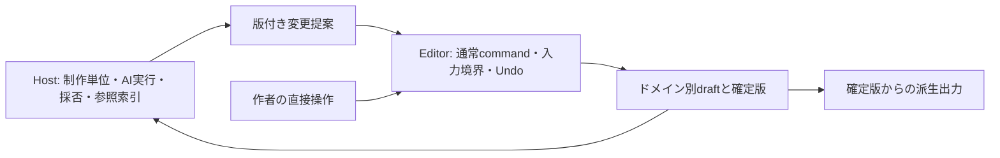

# 漫画制作の共同編集UX設計

設計案 v2、2026-10-28。[Document長編・Designページ構成](../novel-comic-design.md)と[ページ線画・吹き出し](../design-page-artwork.md)の後続案。対象は既存 `document` / `design` 等の再利用と能力追加で、今回の変更は文書のみ。以下の「採用を提案する判断」はレビュー対象であり、合意済み・実装済みという意味ではない。

画面の入口・通常Designとの共存・コマ境界は、後続の[漫画ワークスペース設計](workspace-design.md)で具体化する。本書の「現行」は上記更新日時点の調査であり、後続案は調査時main・取り込み前の実装・追加提案を分けている。専用画面と非矩形の連動コマについては後続案を参照し、全体の制作・参照・保存・ワークフローの責務は本書を引き継ぐ。

## 判断の状態

| 状態                 | この設計で扱うこと                                                                                                                                                                  |
| -------------------- | ----------------------------------------------------------------------------------------------------------------------------------------------------------------------------------- |
| 採用を提案する判断   | ネーム・組版の正本はDesign。段階1は矩形コマ・水平台詞・独立した2ページの見開き表示。コマIDと所属・順序を分離。部分採用は選択から新規proposalを作って再プレビューし、1回のUndoで採用 |
| 実装提案             | 読み順proposal、採用単位の検証、ページ間コマ移動、人物・舞台の参照導線、直接描画。いずれも下記の段階と受入条件を満たすまで未対応                                                    |
| 未決                 | ページをまたぐ1コマのnative model、非矩形clip、Rasterの独立kind、日本語縦書きのsubset。道具を改良するpreset/macroは後続構想で、段階1〜4の実装対象外                                 |
| Hostとの接続判断待ち | 物語資料の正本配置、版固定と索引の更新、制作単位別の承認・復旧。Editor内に製品固有の物語モデルや実行エンジンを作らない                                                              |

## 現行能力と追加範囲

現行の根拠は[Host契約](../authoring-contract.md)、[M0検証](../verification/novel-comic/README.md)、[M1a検証](../verification/design-page-artwork/README.md)、[パス編集ガイド](../vector-authoring/guide.md)。過去の検証結果を今回再実行した結果として扱わない。

| 能力         | 現行の実装・制限                                                                      | 本設計の追加範囲                                                      |
| ------------ | ------------------------------------------------------------------------------------- | --------------------------------------------------------------------- |
| ページ・コマ | `pagination` schema 1。ページはroot frame、コマはページ直属frame。順序はz-orderと独立 | 見開き比較UI、読み順proposal、同一Artifact内のコマ移動                |
| 線と台詞     | schema 3のline/cubic、点編集、group/path/textの尻尾付き吹き出し。水平native text      | 自由描画・パスproposalは段階3。点編集だけを筆圧作画対応としない       |
| 変更提案     | `designPageEditCommand` はbounds/text/imageのM0 subset。pathと読み順は対象外          | 追加のdata adapterと意味的差分。既存adapterの拒否範囲を黙って広げない |
| 出力         | exact versionのページcapture、PNG/PDF。vectorはopt-in、PDFはraster                    | 同版の照合・取得後検査。縦書き・出版製版は別受入                      |
| shared等     | pagination/pathのshared、template/reuse、React経路は非対応                            | 対応を宣言しない。入口を理由付きで拒否し、local fallbackしない        |
| 保存・復旧   | native保存/importと保存失敗時のdraft保持。参照Hostの保存実装                          | 大容量・環境外checkpoint・別環境復旧は段階4の新しいC09受入            |

生成画像を層へ分離して局所修正する経路と、白紙から構造化された線を描く経路は別の能力である。画素の再合成一致から、意味的分離・筆順・隠れた下地の復元を保証しない。

## 作品を作る体験と責務

| 段階         | 人とAIの往復                                                        | 再利用するEditor                                            | 追加能力・Hostの担当                                                       |
| ------------ | ------------------------------------------------------------------- | ----------------------------------------------------------- | -------------------------------------------------------------------------- |
| 構想         | 作者が読後感と対立を書く。AIの別案から段落だけ採用し、作者が改稿    | Document、Whiteboard                                        | Hostの作品入口と設定への導線                                               |
| 脚本         | 台詞を直接直し、対象シーン・コマを開いて読み合わせる                | Documentのnative text preparation、proposal、ElementAddress | Hostがシーンと本文範囲の版付き対応を渡す                                   |
| 人物         | 作者の表情ラフにAIが局所修正を提案し、作者が追筆する                | Designの画像・path・text                                    | 設定の正面/側面/背面、表情、口調・関係への参照。線自体のAI修正は段階3      |
| 舞台         | 平面図を直し、必要に応じて空間とカメラを確認                        | Design、独立したCAD/BIM                                     | exact版の投影adapter。単位・カメラ・出典を保持し、演出上の省略を作者が判断 |
| ネーム       | 作者がコマ・線・台詞を置き、AIの大小・間・めくりの別案を比較        | Design Pages、移動・resize、線presetと点編集                | 段階1は配置・台詞の共同編集。手描きブラシは段階3                           |
| ラフ・作画   | 同じ線/画像層の指定範囲を交互に直す。人物比率、接触、遮蔽を確かめる | native path、画像配置                                       | 直接描画の受入とRasterの選択。画像素材は出典・元版・利用条件を保持         |
| 組版・編集   | 吹き出しと台詞を直し、前後ページから脚本へ戻る                      | M1a、native text、capture                                   | 段階1は水平。縦書き・ルビ・禁則は別能力。通読レビューは人が行う            |
| 出力・引継ぎ | 確定版を固定し、実ファイルと軽量版を確認する                        | native保存、PNG/PDF派生出力                                 | Hostがcheckpoint、取得、再開、公開の判断を行う                             |

物語の出来事時刻と読者への提示順は別データにする。Scheduleは制作予定、Animationは再生時間を担当する。既存 `time-axis` は日単位の計算であり、秒・架空暦・相対前後関係・不明時刻をそのまま扱えるとはしない。Hostが人物の知識、出来事、場所を結ぶ画面を構成し、Editorは公開adapterで選択・参照へ接続する。

## 段階1の実装境界

| 操作               | M0/M1aで再利用する部分                                | 新しい実装・受入                                                                  |
| ------------------ | ----------------------------------------------------- | --------------------------------------------------------------------------------- |
| コマ・台詞の手直し | 矩形frameの移動/resize、水平文字、native履歴          | 新しい自由描画・縦書きを前提にしない                                              |
| 複数レイアウト案   | bounds/text/image commandと差分                       | Hostの並列preview・選択UI。重要場面、無言の間、視線誘導、ページめくりの理由を比較 |
| 見開き             | 2つの独立page frame、各ページcapture                  | Hostの組合せ表示と左右指定。各コマは片側ページにだけ所属                          |
| 読み順のAI案       | `setDesignPagination`、既存IDとvalidator              | 新しい順序data adapterと差分表示。現行 `designPageEditCommand` は順序を受理しない |
| 一部採用           | `ArtifactEditor.propose/acceptProposal`、1採用=1 Undo | 下記の採用単位・依存検査と新proposalの再プレビュー                                |
| 作者の追筆         | line/cubic presetと点編集、台詞入力                   | AIとの同じ線の局所共同描画は段階3。段階1の合格と混同しない                        |

### 見開きとコマのidentity

段階1の見開きは閲覧・比較の組。Hostのview設定に左右のpage IDを持ち、nativeページとcapture順は変更しない。ページ順変更で組合せが不適切になったら再確認する。見開き中央の安全域と台詞の切れを2ページ表示で確認する。

**2ページにまたがる1コマは段階1で非対応。** 1コマを2つの親へ登録する、幅の広いframeを暗黙に2ページ扱いする、といった表現は拒否する。独立spread modelとページ別cropを採るか、別のnative表現を採るかは後続設計で決める。初期受入fixtureの「見開き」はこの2ページ比較に限定する。

同一Artifact内のページ間移動は段階2の追加command案。panel frameと子要素のIDを保持し、`parentId`、旧/新 `panelIds`、子を含む座標変換を一つのtransactionで更新する。移動先と新boundsを明示し、両ページの存在・権限・lock・上限・元revisionを検査する。削除/Undoは同じIDを復元し、複製は新ID。異なるArtifact間の移動はこの段階で拒否する。workflowの項目IDを親ページから生成しないこともHost adapterの必要条件である。

## 部分採用と読み順proposalの契約案

既存coreの `ProposedCommands` と `acceptProposal(id)` の原子的な採用契約を保つ。部分採用は**元proposalのcommand配列をUIで抜き出して即実行する機能にしない**。Design固有のdata adapterとHostのレビュー導線を追加する。以下は実装予定の論理データであり、既存公開型ではない。

- `proposalId / artifactId / baseLocalRevision / referenceVersions`：提案元、対象draft、読んだ外部exact版。対象のrevisionが変われば全案をstaleとして再生成する。自動rebaseは初期対象外。
- `units[] = { id, requires[], operations[] }`：最大32単位・合計100操作の初期subset。空選択、重複ID、未知field、上限超過は拒否。人が選択する最小単位。単位内の操作は不可分。例えば「コマ縮小と台詞枠の再配置」は一単位に束ねる。`requires` は同案内の前提単位IDで、循環・未知IDを拒否する。
- 初期operationは既存M0編集と、`pageOrder` / `panelOrder` の新subset。順序は期待する旧ID列と新ID列を持つ。新列は同じ集合の全単射で、追加/削除/ページ間移動を兼ねない。Native z-order・画像出典・対象外の順序を維持する。
- adapterがnative commandのread/write範囲を導出する。AIの依存申告だけを信用しない。親bounds変更は子への影響も含む。単位間でwrite/writeまたはwrite/readが重なる場合、明示依存が必要。順序は専用のpagination範囲、初期M0編集のread依存は現行どおり保守的に全contentとして扱う。別ページであってもこのread範囲と交差する変更には依存が必要になる。独立性を立証できない変更は同じ単位に束ねるか再提案する。
- 選択集合が`requires`を満たさなければ、足りない単位を示して止める。ユーザーが選択していない変更を自動採用しない。許可された順序に並べた操作をdraftの写しへ適用し、最終native validatorと意味的diffを再検査する。

例：A「コマ縮小＋台詞枠移動」、B「その台詞を短縮」（requires A）。Bだけの選択は拒否。Aのみ、またはA+Bを選ぶと、選択集合を対象に**別IDのproposal**を作り、差分をもう一度表示する。作者の確定操作で既存 `acceptProposal` を呼び、選択集合全体が1 Undoになる。採用後、同じ元revisionを使う残案はstaleとなり、次の採用には再提案が必要。

API変更範囲は `design/pagination` の追加adapter（仮称 `prepareDesignPageProposal`）、`design/page-proposal-diff` の順序diff、通常Pages/参照Hostの選択UI。coreの汎用partial-apply APIや第二の履歴は作らない。既存 `designPageEditCommand` の入力互換性を維持し、現行のpath/shared/未知operationの拒否を保つ。命名と公開型は実装PRで固定する。

previewと採用でreadOnly・入力/IME・gesture・対象ID・元revision・外部参照版を再検査する。外部版は既存のHost proposal freshness経路へ渡す。ローカルpending proposalだけでは外部版の鮮度を保証できない。複数Artifactを跨ぐ採用は段階1の対象外とする。

## 参照と物語資料

Document/Design/CAD等は独立したnative正本を持つ。設定と絵を万能nodeへ統合しない。Hostから渡す参照はArtifact ID、exact version/hash、element ID、必要なら物語項目IDの対応。編集正本と検索/Graphのprojectionを二重に編集しない。

設定の変更から確定的に辿れるのは明示参照のみ。AIの「服装が違う」「この人物はまだ秘密を知らない」は候補として示し、引用の無い部分を影響なしと断定しない。削除はorphan、版変更はoutdatedとして作者に示す。意図的なミスリード・省略・信頼できない語り手を許し、完成原稿を自動更新しない。

## 直接描画とRasterの判断条件

最初はDesignのline/cubicと自由描画入力の対応を検討する。Rasterの独立kindは未決。独立modelが必要なら[Editor設計テンプレート](../editor-proposal-template.md)でkind・schema・タイル/資産・保存・adapterを別途固定する。以下の機能判定を段階3の入口に置く。

| 固定する課題         | 判定方法と分岐                                                                                                                                                                                                                                                 |
| -------------------- | -------------------------------------------------------------------------------------------------------------------------------------------------------------------------------------------------------------------------------------------------------------- |
| ラフの線             | 1ページ512stroke×最大16anchor（合計8192）、1stroke=1pathのfixture案で、線の選択・移動・保存・Undoと表現を確認。数は性能保証でなく機能検査の対象規模                                                                                                            |
| 既存上限             | 現行pathは1要素128subpath、4096anchor/segment、Design全体16384anchor/segment、path JSON合計8 MiB。Host native JSONはdraftと保持版を含む16 MiB。fixtureを超える実原稿がこの上限で拒否されるなら、Artifact分割・資産分離とRaster案を比較し、黙って上限を上げない |
| 部分消去             | 1本の線を中央で切り、残った2片を個別に編集・再保存できるか。切断点精度とID対応を定義する。現行の点編集では未対応。vector splitを追加すれば足りるかを機能prototypeで判定                                                                                        |
| 筆圧・トーン・マスク | 線幅の連続変化、8層の合成、alpha消去、部分マスク、トーンを要求するfixtureを別に用意。pathへ潰すと必要な編集意味を失う場合、Raster domainの設計へ進む                                                                                                           |
| 画像の局所修正       | 元画像と修正範囲外・他層の画素不変を検査。意味的な層分離と下地の補完は別の視覚レビュー。直接線画fixtureの代用にしない                                                                                                                                          |

機能prototypeでは時間・メモリ・fpsの計測やtuningを行わない。この設計は性能測定の実施承認を含まない。性能評価を行う際は、端末、workload、sample、latency/memory budgetを別プロトコルで固定する。閾値超過の入力拒否と性能不合格を混同しない。実機筆圧・高解像度製版・長期連載の受入は別条件。

作者が道具を改良するpreset・macro構想は残すが、段階1〜4の完了条件から外す。既存extensionは実験段階。後続案ではdata-only操作、許可command、版固定、権限、preview、Cancel、保存・ID remapを設計し、presetならC05、linked updateならC06を適用する。任意コード実行や別catalog/Undo/AI runtimeを先に作らない。

## 保存・出力の境界

Editorはdraft/immutable version、native command、入力境界、hash検証、保存失敗・容量診断、exact版captureを提供する。**Host UI**が「保存済み」を表示し、正本の選択、担当/権限、checkpointの完了、別環境からの回収を扱う。Editorのnative保存成功と、環境外の資産を含むcheckpoint成功は別状態で表示する。

Hostはmanifest・必要資産・版の整合確認後にcheckpoint完了を示す。未保存draftとUndoを保存失敗で破棄しない。古い担当の復帰はHostの担当/権限/元版再確認で止め、Editorのstale拒否と接続する。これらは既存M0のproduction durability保証ではなく、新しいC09統合受入を要する。

出力は原稿を変更しない派生物。同一exact版からPDF・ページ画像・軽量版を作り、台詞全文、ページ/コマ順、吹き出し、切れ、中央安全域、細線を確認する。PDFは現行rasterなので文字抽出を完全性検査の代用にせず、元の台詞一覧とページ描画の対応検査・人の通読を併用する。取得先から再取得したbytesとmanifestも照合する。

## 段階・条件・非対応

下記は今後の受入計画。今回の文書変更で機能のPASSを追加しない。[条件ID](../editor-acceptance.md)の必須N01–N14は各実装差分へ適用し、重点条件を併記する。

| 段階             | 対象package/Host                                                  | 受入scenarioと重点条件                                                                                                                                                                                                             |
| ---------------- | ----------------------------------------------------------------- | ---------------------------------------------------------------------------------------------------------------------------------------------------------------------------------------------------------------------------------- |
| 1 共同ネーム     | Design pagination/diff/Pages、editor-hostの既存採用経路、独立Host | 4ページ×複数矩形コマ。人の配置・水平台詞→複数AI案→依存に沿う部分採用→直接修正→脚本へ戻る。2ページ比較とめくりを視覚レビュー。ID/対象外不変、Undo/Redo、Cancel、readOnly、stale、IME、保存reload、PNG/PDF。N02–N11、C01/C02/C03/C07 |
| 2 設定・群像劇   | 参照adapter、Designのページ間移動、Hostの物語ビュー               | 3人・2筋・回想で作品内順と提示順を独立変更。知識/所在からコマへ移動。panel移動後もID/引用一致。明示影響・意味候補・例外を区別。N02/N03/N08/N09/N10、C02/C03。CAD投影を宣言する場合C07                                              |
| 3 直接描画       | Design自由描画/path proposal、必要なら別Raster設計                | 上記機能fixtureを通常UI/独立Hostで検証。人とAIが同じ線を直す経路とPNG編集を別判定。線の品質は作者が評価。N02/N04/N05/N06/N07/N10/N11/N12、C03/C07。大資産はC09、実機筆圧を宣言する場合C10                                          |
| 4 復旧・最終出力 | 保存/出力adapterとHost checkpoint・権限UI                         | 固定10ページ。欠損/破損資産・容量超過・途中失敗・古い担当復帰、別環境から再編集/再出力。実ファイルの台詞/順序/細線確認。N03/N09/N10/N12、C07/C09。Host運用の受入を別記                                                             |

C04/sharedは新subsetで非対応のため入口拒否。C05/C06はpreset・reuseを本計画で宣言せず拒否。C08/React変換も対象外。実機を用いない段階1のmobile viewport検証をC10の実機受入に読み替えない。高解像度・大量原稿や性能・公開の受入も独立に判断する。

段階1〜3の通常UI/独立Hostはdesktop 1440×900とmobile 390×844のChromium emulationを初期検証条件とし、keyboard/focus/入力中shortcut/画面切れとbrowser errorを確認する。OS native IMEと実機は別にNOT RUN/PASSを記録する。
